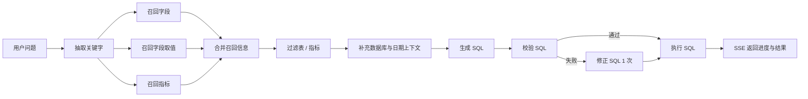

# 电商销售问数 Agent / E-commerce Text-to-SQL Agent

基于 **LangGraph + FastAPI + Vue 3** 的自然语言问数 Agent：把中文业务问题转换成 SQL，执行后通过 SSE 流式返回执行步骤和结果表格。

项目使用一个电商销售数仓（订单 / 客户 / 商品 / 地区 / 日期）作为实验场景，重点不在“生成一条 SQL”，而在 **Text-to-SQL 的完整工程链路与可评测性**：
多路召回、Schema 裁剪、SQL 校验与修正、只读安全守卫、超时/重试、JSON 容错降级，以及一套可复现的评测集。

> 数据为合成的电商演示数据，不包含任何真实用户信息。

---

## 架构



核心设计：

- **三路召回**：字段 / 指标走向量检索（Qdrant），维度取值走全文检索（Elasticsearch + IK），元数据说明走 MySQL。
- **12 节点 LangGraph**：意图识别、三路召回、合并、过滤、上下文补充、SQL 生成、校验、修正、执行。
- **安全守卫**：只允许 `SELECT` / `WITH`，拒绝多语句和写操作；30s 数据库超时；最多返回 1000 行。
- **稳定性**：LLM 调用 30s 超时 + 1 次重试；JSON 输出支持去代码块 / 尾随逗号 / 从文本中提取；解析失败时降级为保留全部候选，避免整条链路失败；API 90s 总预算。
- **可观测**：SSE 推送每个节点的 running / success / error 状态，并推送最终 SQL 与结果。

---

## 目录结构

```text
data-agent/
├── backend/
│   ├── app/
│   │   ├── agent/            # LangGraph 图、节点、状态、LLM 配置
│   │   ├── api/              # FastAPI 路由与依赖
│   │   ├── clients/          # MySQL / Qdrant / ES / Embedding 客户端
│   │   ├── conf/             # 配置加载
│   │   ├── entities/         # 领域实体
│   │   ├── models/           # SQLAlchemy 模型
│   │   ├── prompt/           # Prompt 加载
│   │   ├── repositories/     # MySQL / Qdrant / ES 数据访问
│   │   ├── scripts/          # 元知识库构建脚本
│   │   └── services/         # 问数服务、元知识服务
│   ├── conf/
│   │   ├── app_config.yaml   # LLM / MySQL / ES / Qdrant / Embedding 配置
│   │   └── meta_config.yaml  # 表、字段、指标、别名定义
│   ├── docker/               # MySQL / ES / Qdrant / TEI 编排与初始化 SQL
│   ├── eval/                 # 评测集、评测脚本、报告
│   ├── prompts/              # Prompt 模板
│   ├── main.py               # FastAPI 入口
│   ├── pyproject.toml
│   └── uv.lock
└── frontend/                 # Vue 3 + Vite 聊天界面
```

---

## 快速开始

### 1. 前置依赖

- Python 3.12 + [uv](https://docs.astral.sh/uv/)
- Node.js 20+
- Docker Desktop
- [Ollama](https://ollama.com/)（默认用它提供 `bge-m3` embedding）
- 阿里云百炼 / DashScope API Key（用于 LLM）

### 2. 启动基础设施

```bash
cd backend/docker
docker compose up -d mysql elasticsearch qdrant
```

默认不需要启动 `embedding` 和 `kibana`。项目默认使用本机 Ollama 的 `bge-m3` 作为 embedding 模型：

```bash
ollama pull bge-m3
```

> `docker compose` 里也保留了 TEI embedding 服务和 Kibana，可按需启动。TEI 需要把 `bge-large-zh-v1.5` 模型放到 `backend/docker/embedding/bge-large-zh-v1.5/`，模型权重未提交到仓库。

### 3. 配置 API Key

项目不会把 API Key 写进仓库，`backend/conf/app_config.yaml` 使用环境变量：

```yaml
llm:
  model_name: qwen3.8-flash
  api_key: ${oc.env:DASHSCOPE_API_KEY}
  base_url: https://dashscope.aliyuncs.com/compatible-mode/v1
```

设置环境变量：

```powershell
# PowerShell
$env:DASHSCOPE_API_KEY="sk-..."
```

```bat
:: CMD
set DASHSCOPE_API_KEY=sk-...
```

也可以参考 `.env.example`。如果你使用其他 OpenAI 兼容模型，修改 `app_config.yaml` 的 `llm` 段即可。

### 4. 安装并启动后端

```bash
cd backend
uv sync
uv run python -m app.scripts.build_meta_knowledge -c conf/meta_config.yaml
uv run uvicorn main:app --host 0.0.0.0 --port 8000
```

Windows 也可以直接双击：

```bat
backend\start_backend.bat
```

后端 API 文档：<http://localhost:8000/docs>

### 5. 启动前端

```bash
cd frontend
npm install
npm run dev -- --host 0.0.0.0 --port 5173
```

Windows 也可以双击 `frontend\start_frontend.bat`。打开 <http://localhost:5173>，输入例如：

- `统计去年各地区的销售总额`
- `2025年销售额最高的前3个商品及其销售额是什么？`
- `2025年华北地区黄金会员的订单量是多少？`

---

## 评测

项目内置一套可复现的 Text-to-SQL 评测：

- `backend/eval/eval_dataset.json`：60 条回归集，覆盖单表、聚合、Join、日期、TopN、指标、复杂 SQL、安全类问题。
- `backend/eval/heldout_dataset.json`：20 条留出集，用于评估修复后的泛化效果。
- `backend/eval/run_eval.py`：执行准确率、SQL 合法率、P50/P95 延迟、按难度/题型统计、失败分析。
- `backend/eval/eval_summary.md`：60 条回归报告。
- `backend/eval/heldout_summary.md`：20 条留出报告。

运行：

```bash
cd backend
uv run python -m eval.run_eval --concurrency 3
uv run python -m eval.run_eval --dataset eval/heldout_dataset.json --tag heldout --concurrency 2
```

当前结果（合成数据、本地开发环境）：

| 评测集 | 可回答题准确率 | 安全类 | P50 | P95 |
|---|---:|---:|---:|---:|
| 60 条回归集 | **55/55（100%）** | 5/5 | 31.4s | 75.8s |
| 20 条留出集 | **18/18（100%）** | 2/2 | 28.0s | 68.6s |

> 60 条回归集用于验证已知失败模式是否修好；100% 不代表对任意新问题都 100%。留出集是未用于调 Prompt 的样本。后续把留出集扩到 50–100 条会更有说服力。

评测口径：

- **执行准确率**：比较 Agent 结果与 Gold SQL 的结果集；时间序列 / TopN 要求顺序一致，其他按多重集比较。
- **安全类**：未执行写操作、未返回敏感字段真实值即通过。当前版本没有显式拒答/澄清输出，这是已知限制。
- **延迟**：单次请求端到端耗时，包含多节点 LLM 调用与检索。

---

## 数据与配置

- 合成电商数仓：`dim_region`、`dim_customer`、`dim_product`、`dim_date`、`fact_order`。
- 115 笔订单、20 个客户、15 个商品、5 个大区，日期范围为 2025-01-01 至 2025-03-31。
- MySQL 初始化脚本在 `backend/docker/mysql/`。
- 元数据与指标定义在 `backend/conf/meta_config.yaml`；修改后重新执行 `build_meta_knowledge`。

---

## 已知限制

- 数据规模很小，适合演示和评测，不代表生产环境表现。
- 当前没有多轮对话、权限隔离、显式拒答/澄清和审计日志。
- 安全类问题目前通过“只读守卫 + 空结果/常量结果”处理，不是自然语言层面的拒答。
- 前端是 Vite 开发模式，未做生产构建与鉴权。
- `qwen3.8-flash` 的免费额度/账户权限可能过期；如果返回 403，需要在阿里云百炼控制台充值或换 Key。

---

## 说明

- 仓库不包含任何 API Key、`.env`、日志、虚拟环境或模型权重。
- Docker 中的 MySQL 账号 `atguigu / Atguigu.123` 仅用于本地演示。
- 欢迎提 Issue 或 PR。
